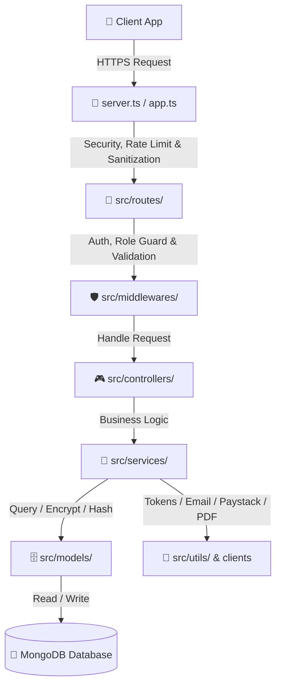

# NIBSS Wallet Backend Architecture

This document provides a comprehensive overview of the `backend` architecture, all features implemented so far, the directory layout, API endpoints, and security/testing setup for the NIBSS Wallet API.

---

## ✅ What Has Been Built So Far

### 1. Authentication, Email Verification & Password Reset
- **Registration & Login:** User registration with duplicate email/phone checks, automatic NGN wallet provisioning (with a unique 10-digit account number), bcrypt password hashing, and JWT access + refresh token pairs.
- **Email Verification:** 6-digit OTP generation and email delivery via Resend (`verify-email`, `resend-otp`).
- **Password Reset & Session Invalidation:** `forgot-password` and `reset-password` flows using hashed reset tokens, attempt tracking, and `passwordChangedAt` checks in auth middleware to invalidate older JWTs.

### 2. User Profile, Onboarding & Transaction PIN
- **Profile Management:** View and update profile details (`GET /users/me`, `PATCH /users/me`) and change passwords (`PATCH /users/me/change-password`).
- **Transaction PIN:** Set and verify 4-digit transaction PINs (`POST /users/me/set-pin`), stored hashed via `bcryptjs`.
- **Onboarding Tracking:** Dedicated onboarding status endpoint (`GET /onboarding/status`) tracking `profile`, `kyc`, and `pin` steps and automatically syncing `isComplete`.

### 3. Wallets, P2P Transfers & PDF Receipts
- **Wallet Operations:** Fetch wallet details, check balances, and look up recipient accounts by 10-digit account number (`GET /wallet`, `GET /wallet/balance`, `GET /wallet/lookup/:accountNumber`).
- **Transfers & Idempotency:** Atomic wallet-to-wallet transfers with PIN verification, daily transfer limit enforcement (Tier 1: ₦50,000), and sender-scoped idempotency keys to prevent duplicate debits.
- **Receipts:** Downloadable PDF transaction receipts generated with `pdfkit` (`GET /wallet/transactions/:id/receipt`).

### 4. Paystack Test-Mode Wallet Funding
- **Initialize Funding:** `POST /wallet/fund` creates a `pending` deposit record and initializes a Paystack checkout session (`sk_test_` only — live Paystack keys are blocked by env validation).
- **Signed Webhook:** `POST /api/v1/paystack/webhook` captures the raw request body before JSON parsing, verifies the `x-paystack-signature` HMAC-SHA512 header, re-verifies with Paystack, and credits the wallet idempotently.
- **Manual Verification:** `GET /api/v1/paystack/verify/:reference` allows authenticated users to verify and settle pending deposits.

### 5. Transaction History & Notifications
- **Transactions:** Paginated transaction history and single-transaction detail lookup (`GET /transactions`, `GET /transactions/:id`) covering `transfer`, `reversal`, and `funding` types.
- **Notifications:** Automated alerts for transfers, funding, KYC updates, and security events, with endpoints to list, mark read, mark all read, and delete notifications.

### 6. KYC Verification
- **KYC Submission & Status:** Submit NIN/BVN details (`POST /kyc/submit`) and check verification status (`GET /kyc/status`).
- **Data Protection:** NIN and BVN values are encrypted at rest using **AES-256-GCM** and masked when returned to clients.

### 7. Feedback & Admin Management
- **Feedback:** Users can submit and view their own feedback (`POST /feedback`, `GET /feedback/mine`); admins can list, update, and delete feedback.
- **Admin Console (`/api/v1/admin`):** Role-gated (`restrictTo("admin")`) endpoints for listing/inspecting users, freezing/unfreezing accounts, viewing user wallets and platform transactions, platform stats, reviewing pending KYC requests, and querying admin audit logs (`AuditLog`).
- **Admin Seeding:** `src/scripts/seedAdmin.ts` for bootstrapping an admin account from environment variables.

### 8. Security Hardening, Validation & Testing
- **Middleware Hardening:** `helmet`, `cors`, `cookie-parser`, `express.json({ limit: "10kb" })`, `rejectUnsafeKeys` (NoSQL/prototype-pollution key sanitization), `express-validator` schemas, and tiered rate limiters (`globalLimiter`, `loginLimiter`, `registerLimiter`, `otpLimiter`, `transferLimiter`, `fundLimiter`).
- **Environment Validation:** `src/config/env.ts` validates required secrets at startup and enforces production secret length/placeholder checks.
- **Automated Test Suite:** 20+ Jest + Supertest integration and unit test suites running against `mongodb-memory-server`.

---

## 📂 Directory Layout

```
backend/
├── ⚙️ Root Configuration Files
│   ├── .env               # Local environment secrets (ignored by git)
│   ├── .env.example       # Template for required environment variables
│   ├── eslint.config.js   # ESLint code quality rules & parser configuration
│   ├── jest.config.mjs    # Jest configuration for ESM + TypeScript tests
│   ├── nodemon.json       # Hot-reload configuration for development
│   ├── package.json       # Project dependencies and running scripts
│   └── tsconfig.json      # TypeScript compiler configuration (NodeNext, strict)
│
└── 🛠️ src/ (Source Code)
    ├── server.ts          # Application entry point, env validation & server bootstrapper
    ├── app.ts             # Express app setup, webhook raw-body route, security & API routers
    │
    ├── 📁 config/
    │   ├── database.ts    # Mongoose MongoDB connection
    │   └── env.ts         # Startup environment variable & secret validation
    │
    ├── 📁 models/
    │   ├── auditLog.model.ts     # Admin action audit trail schema
    │   ├── deposit.model.ts      # Paystack funding deposit schema
    │   ├── feedback.model.ts     # User feedback schema
    │   ├── notification.model.ts # In-app notification schema
    │   ├── transaction.model.ts  # Transfer, reversal & funding ledger schema
    │   ├── user.model.ts         # User schema, pre-save hashing/encryption & instance methods
    │   └── wallet.model.ts       # NGN wallet schema, account number & daily limit tracking
    │
    ├── 📁 types/
    │   ├── audit.types.ts        # Audit log types
    │   ├── deposit.types.ts      # Deposit status & interface types
    │   ├── feedback.types.ts     # Feedback types
    │   ├── notification.types.ts # Notification types
    │   ├── transaction.types.ts  # Transaction types
    │   ├── user.types.ts         # IUser, IKyc, IOnboarding & related types
    │   └── wallet.types.ts       # IWallet & related types
    │
    ├── 📁 utils/
    │   ├── accountNumber.utils.ts # Unique 10-digit NUBAN-style account number generator
    │   ├── AppError.ts            # Custom operational error class
    │   ├── catchAsync.ts          # Async controller error wrapper
    │   ├── email.utils.ts         # Resend email helpers (OTP, password reset)
    │   ├── encryption.utils.ts    # AES-256-GCM encrypt/decrypt helpers for NIN & BVN
    │   ├── jwt.utils.ts           # Access & refresh token generation/verification
    │   ├── otp.utils.ts           # OTP & reset token generation/hashing helpers
    │   ├── pagination.ts          # Shared pagination query helper
    │   └── receipt.utils.ts       # PDFKit transaction receipt generator
    │
    ├── 📁 services/
    │   ├── admin.service.ts        # Admin user, wallet, KYC review, stats & audit log logic
    │   ├── auth.service.ts         # Register, login, refresh, OTP verification & password reset
    │   ├── feedback.service.ts     # Feedback creation, listing, update & deletion
    │   ├── funding.service.ts      # Paystack funding initialization, webhook & verify settlement
    │   ├── kyc.service.ts          # KYC submission & status retrieval
    │   ├── notification.service.ts # Notification creation, read/delete operations
    │   ├── onboarding.service.ts   # Onboarding step status & completion sync
    │   ├── paystack.client.ts      # Paystack HTTP client & webhook signature verification
    │   ├── transaction.service.ts  # Paginated transaction history & detail queries
    │   ├── transfer.service.ts     # Atomic P2P transfers, idempotency & daily limits
    │   ├── user.service.ts         # Profile retrieval/update, password change & PIN setup
    │   └── wallet.service.ts       # Wallet retrieval, balance, account lookup & limit checks
    │
    ├── 📁 controllers/             # HTTP request/response handlers for each domain
    ├── 📁 middlewares/
    │   ├── auth.middleware.ts      # `protect` JWT guard & `restrictTo` role guard
    │   ├── error.middleware.ts     # Global Express error formatter
    │   ├── rateLimit.middleware.ts # Global, login, register, OTP & transfer rate limiters
    │   ├── sanitize.middleware.ts  # `rejectUnsafeKeys` against `$` / `__proto__` injection
    │   ├── validate.middleware.ts  # express-validator result checker
    │   └── validators/             # Request validation chains (admin, auth, feedback, funding, kyc, transfer, user)
    │
    ├── 📁 routes/                  # Express routers + `rateLimit.middleware.ts` (`fundLimiter`)
    ├── 📁 scripts/
    │   └── seedAdmin.ts            # CLI script to seed an admin user
    │
    └── 📁 __tests__/               # Jest + Supertest unit & integration test suites
        ├── setup.ts                # MongoDB Memory Server setup & teardown
        ├── helpers.ts              # Shared test user & auth helpers
        └── *.test.ts               # Suites for auth, password-reset, user, onboarding, wallet, transfer,
                                    # funding, transaction, kyc, notification, feedback, admin,
                                    # ratelimit, security, encryption, jwt, middleware, utils & app
```

---

## ⚙️ Scripts & Environment Variables

### Key NPM Scripts (`backend/package.json`)
- `npm run dev`: Runs the server in development mode with `nodemon` + `tsx`.
- `npm run build`: Compiles TypeScript to JavaScript in `dist/`.
- `npm start`: Runs the compiled production server (`node dist/server.js`).
- `npm run type-check`: Validates TypeScript types (`tsc --noEmit`).
- `npm run lint` / `npm run lint:fix`: Checks/fixes code style and lint rules with ESLint.
- `npm test` / `npm run test:watch` / `npm run test:coverage`: Runs Jest unit & integration tests.

### Environment Variables (`.env.example`)
- **Required:** `MONGO_URI`, `JWT_ACCESS_SECRET`, `JWT_REFRESH_SECRET`, `ENCRYPTION_KEY`
- **Server & URLs:** `PORT`, `NODE_ENV`, `FRONTEND_URL`, `RAILWAY_URL`
- **JWT Expiry:** `JWT_ACCESS_EXPIRES_IN`, `JWT_REFRESH_EXPIRES_IN`
- **Email (Resend):** `RESEND_API_KEY`, `FROM_EMAIL`
- **Paystack (Test Mode Only):** `PAYSTACK_SECRET_KEY` (must not start with `sk_live_`), `PAYSTACK_BASE_URL`, `TEST_SECRET_KEY`, `TEST_PUBLIC_KEY`
- **Admin Seeding:** `ADMIN_EMAIL`, `ADMIN_PASSWORD`, `ADMIN_PHONE`

---

## 📍 API Endpoints

| Router | Prefix | Endpoints |
|--------|--------|-----------|
| `app.ts` | `/api` | `GET /health` |
| `app.ts` | `/api/v1/paystack` | `POST /webhook` (raw JSON body + signature verification) |
| `paystack.routes.ts` | `/api/v1/paystack` | `GET /verify/:reference` |
| `auth.routes.ts` | `/api/v1/auth` | `POST /register`, `POST /login`, `POST /logout`, `POST /refresh-token`, `POST /verify-email`, `POST /resend-otp`, `POST /forgot-password`, `POST /reset-password` |
| `user.routes.ts` | `/api/v1/users` | `GET /me`, `PATCH /me`, `PATCH /me/change-password`, `POST /me/set-pin` |
| `onboarding.routes.ts` | `/api/v1/onboarding` | `GET /status` |
| `wallet.routes.ts` | `/api/v1/wallet` | `GET /`, `GET /balance`, `GET /lookup/:accountNumber`, `POST /fund`, `POST /transfer`, `GET /transactions/:id/receipt` |
| `transaction.routes.ts` | `/api/v1/transactions` | `GET /`, `GET /:id` |
| `kyc.routes.ts` | `/api/v1/kyc` | `POST /submit`, `GET /status` |
| `notification.routes.ts` | `/api/v1/notifications` | `GET /`, `PATCH /read-all`, `PATCH /:id/read`, `DELETE /:id` |
| `feedback.routes.ts` | `/api/v1/feedback` | `POST /`, `GET /mine`, `GET /` (admin), `PATCH /:id` (admin), `DELETE /:id` (admin) |
| `admin.routes.ts` | `/api/v1/admin` | `GET /users`, `GET /users/:id`, `PATCH /users/:id/freeze`, `PATCH /users/:id/unfreeze`, `GET /wallets/:userId`, `GET /transactions`, `GET /stats`, `GET /kyc/pending`, `PATCH /kyc/:id`, `GET /audit-logs` |

---

## 🌊 Request Lifecycle Flow


